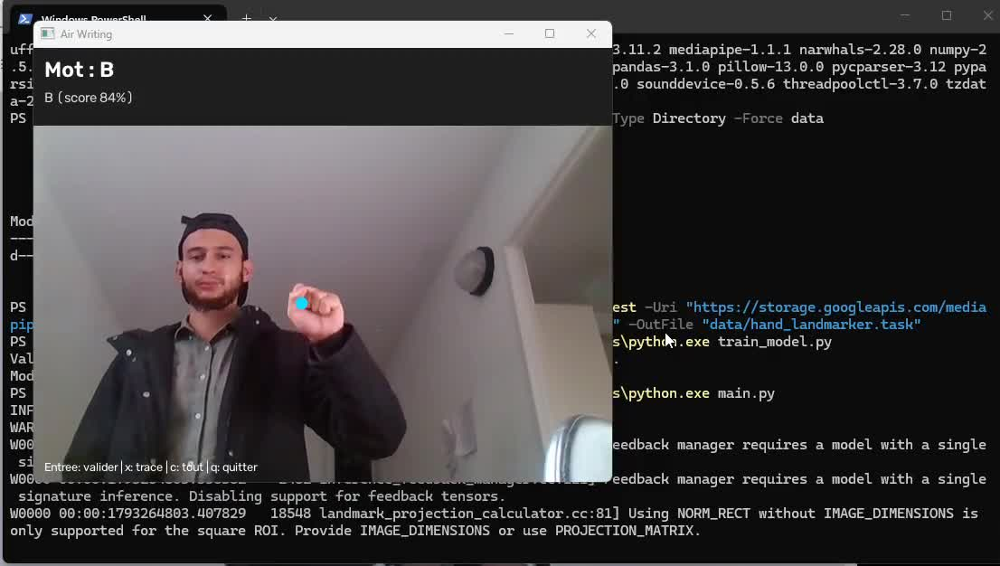

# ✍️ Air Writing — Lettres, mots et synthèse vocale

**Interaction gestuelle en temps réel — MediaPipe · OpenCV · scikit-learn**

   

**Air Writing** est un prototype de vision par ordinateur qui permet de tracer des lettres devant une webcam avec son index. Le programme transforme un geste en image, prétraite celle-ci puis utilise un réseau de neurones multicouches pour prédire une lettre de l'alphabet.

## 🎬 Démonstration vidéo

[](https://github.com/NAZMO1/air-writing/blob/main/docs/media/air-writing-demo.mp4)

**[▶ Voir la démonstration (21 secondes)](https://github.com/NAZMO1/air-writing/blob/main/docs/media/air-writing-demo.mp4)** — Cliquez sur l’aperçu pour ouvrir la vidéo et lancer la lecture sur GitHub.

[ Télécharger la vidéo MP4](https://github.com/NAZMO1/air-writing/raw/refs/heads/main/docs/media/air-writing-demo.mp4)

## ✨ Fonctionnalités

- Détection d'une main et de ses **21 points de repère** avec MediaPipe Hand Landmarker.
- Dessin sur un canevas virtuel lorsque **l'index est levé**.
- Validation après **1,2 seconde avec les doigts repliés**, ou avec **Entrée**. La perte de main ne valide pas la lettre.
- Main ouverte maintenue **0,8 seconde** pour réinitialiser le texte et le tracé.
- Affichage en direct de la webcam, du tracé et des lettres reconnues.
- Prétraitement commun à l’entraînement et à la reconnaissance : zone utile, redimensionnement et centrage, y compris pour les lettres fines.
- Classification des lettres **A–Z** avec `MLPClassifier` de scikit-learn.
- Génération d'exemples synthétiques avec rotation, décalage et changements d'épaisseur des lettres.

## Mots français / anglais et lecture vocale

Écrivez **une lettre à la fois**, validez-la avec Entrée ou en repliant les doigts,
puis continuez le mot. `L` bascule entre les dictionnaires français et anglais
(le français est sélectionné au lancement). La langue est choisie manuellement.

- Le mot courant est signalé comme reconnu lorsqu'il appartient au dictionnaire.
- Jusqu'à trois suggestions sont proposées : `1`, `2` ou `3` applique la suggestion
  correspondante et ajoute un espace. Les variantes accentuées françaises sont proposées
  même si les lettres tracées A–Z ne portent pas d'accent.
- **Espace** conserve le mot tel quel et passe au suivant, y compris pour les noms propres.
  Aucun mot n'est corrigé automatiquement. Un tracé restant doit d'abord être validé
  avec Entrée ou effacé avec `x`.
- **V** lit tout le texte ; **B** lit le dernier mot, avec une voix de la langue sélectionnée.
- Retour arrière supprime le dernier caractère, y compris un espace.
- La webcam reste active pendant la lecture. Une nouvelle lecture est refusée tant que
  la précédente n'est pas terminée ; quitter l'application arrête aussi la voix.

**Mise à jour d'une installation existante :**

```bash
git pull
python -m pip install "pyspellchecker>=0.8.1,<1" "pyttsx3>=2.98,<3"
python main.py
```

Aucun réentraînement supplémentaire n'est nécessaire pour ces fonctions si votre
modèle de lettres fonctionne déjà. Les dictionnaires sont inclus dans pyspellchecker ;
le texte et la voix sont traités localement, sans API ni clé payante.

**Voix système :** installez les voix française et anglaise dans les paramètres de
langue/parole de Windows ou de macOS. Sur Ubuntu/Debian, installez le moteur eSpeak :

```bash
sudo apt install espeak-ng libespeak1
```

Pour vérifier la voix indépendamment de la webcam :

```bash
python -m src.speech --language fr --text "Bonjour tout le monde"
python -m src.speech --language en --text "Hello world"
```

Si une voix ou le moteur manque, l'application affiche un message et le terminal
explique l'erreur ; l'écriture reste disponible. Sous WSL, l'accès caméra/audio dépend
de votre configuration : privilégiez Windows natif pour utiliser les deux ensemble.
L'affichage OpenCV retire les accents pour la lisibilité, mais le texte interne et
la synthèse vocale les conservent.

**Limites :** il s'agit d'assembler des lettres puis de consulter un dictionnaire,
pas de reconnaître un mot cursif entier en un seul tracé. Les suggestions ne comprennent
pas le contexte d'une phrase et peuvent être incorrectes. Elles couvrent une modification
orthographique et les variantes accentuées ; les mots de plus de 32 caractères ne sont
pas analysés. La lecture est limitée à 2 000 caractères par demande.

## 🧱 Pipeline technique

```text
Webcam → MediaPipe Hand Landmarker
           │
           ▼
       Analyse des gestes
           │
           ├── Index levé → Tracé sur canevas
           ├── Main ouverte → Effacement
           └── Doigts replies > 1,2 s → Classification
                                  │
                                  ▼
                       Prétraitement OpenCV
                       ROI → 20×20 → 28×28
                                  │
                                  ▼
                      784 valeurs normalisées
                                  │
                                  ▼
                       MLPClassifier → A–Z
                                  │
                                  ▼
                      Texte affiché à l'écran
```

| Composant | Technologie |
| --- | --- |
| Capture et affichage | OpenCV |
| Détection gestuelle | MediaPipe Tasks |
| Calcul | NumPy |
| Classification | scikit-learn, MLP |
| Données synthétiques | Pillow, OpenCV |
| Sauvegarde du modèle | joblib |

## 🚀 Installation et lancement

**Prérequis :** Python et dépendances compatibles avec `requirements.txt`, webcam accessible et bibliothèques graphiques système nécessaires à OpenCV.

```bash
git clone https://github.com/NAZMO1/air-writing.git
cd air-writing
python -m venv .venv

# Linux/macOS
source .venv/bin/activate
# Windows PowerShell : .venv\Scripts\Activate.ps1

pip install -r requirements.txt
```

**1. Télécharger le détecteur MediaPipe :**

```bash
mkdir -p data
curl -L "https://storage.googleapis.com/mediapipe-models/hand_landmarker/hand_landmarker/float16/1/hand_landmarker.task" -o data/hand_landmarker.task
```

**2. Entraîner le modèle de lettres :**

```bash
python train_model.py
```

Le script génère des lettres synthétiques et sauvegarde le classifieur dans `data/letter_model.pkl`. Ces deux fichiers de modèles ne figurent pas actuellement dans le dépôt : leur préparation est indispensable avant le premier lancement.

**3. Démarrer :**

```bash
python main.py
```

| Action | Geste ou touche |
| --- | --- |
| Dessiner | Index levé, autres doigts repliés |
| Déclencher une prédiction | Replier les doigts 1,2 s, ou appuyer sur Entrée |
| Réinitialiser | Main ouverte pendant 0,8 s |
| Effacer seulement le tracé | `x` |
| Supprimer le dernier caractère | Retour arrière |
| Changer de langue FR/EN | `l` |
| Ajouter un espace | Espace |
| Accepter une suggestion et ajouter un espace | `1`, `2`, `3` |
| Lire tout le texte / le dernier mot | `v` / `b` |
| Effacer | `c` |
| Quitter | `q` |

## 📁 Organisation

```text
air-writing/
├── main.py                # Capture vidéo, gestes et affichage
├── train_model.py         # Création des données et entraînement
├── test_cam.py            # Test de la caméra
├── src/
│   ├── __init__.py
│   ├── hand_tracker.py    # Détection de main avec MediaPipe
│   ├── words.py           # Composition et suggestions FR/EN
│   ├── speech.py          # Synthèse vocale hors ligne dans un processus séparé
│   └── classifier.py      # Prétraitement et classification
├── requirements.txt
└── README.md

data/                      # Dossier créé localement
├── hand_landmarker.task   # Modèle MediaPipe téléchargé
└── letter_model.pkl       # Modèle entraîné
```

## 🧠 Modèle de classification

`train_model.py` tente de produire **300 exemples par lettre**, soit jusqu'à **7 800 images** réparties sur les 26 classes. Les caractères synthétiques sont déformés puis normalisés en **28 × 28 pixels**. Le classifieur utilise deux couches cachées de **128 et 64 neurones**.

L’inférence retient une lettre si le score maximal atteint **0,60** et dépasse le deuxième score d’au moins **0,15**. Ces seuils heuristiques ne sont pas une mesure de précision et restent configurables dans `LetterClassifier`. Un tracé incertain reste visible pour être corrigé ou effacé avec `x`.

L’entraînement mélange plusieurs polices TrueType disponibles et des caractères OpenCV à traits simples, avec rotation, inclinaison et variations d’épaisseur. Il utilise un générateur aléatoire reproductible et réserve 20 % des exemples pour une validation synthétique séparée. Cette validation ne mesure pas la précision sur des gestes réels ; les exemples partagent les mêmes familles de polices. En l’absence de police TrueType, le script donne une erreur explicite au lieu d’utiliser une petite police de secours.

**Après cette mise à jour, réentraînez le modèle** :

```bash
git pull
python train_model.py
python main.py
```

Sur un PC limité, un essai plus court est possible : `python train_model.py --samples 100 --iterations 40`. L’entraînement utilise au maximum deux threads de calcul BLAS. Aucune carte NVIDIA n’est nécessaire pour cette application. Sous Windows, préférez une exécution native si la webcam n’est pas accessible dans WSL.

## Suivi du doigt

- MediaPipe fonctionne en mode vidéo avec des horodatages strictement croissants.
- Les angles des articulations remplacent la simple comparaison verticale : la logique tolère une rotation dans le plan et les deux mains.
- Le début de tracé attend 80 ms de geste stable. Un lissage adaptatif réduit les tremblements ; les sauts de plus de 12 % de la diagonale de l’image coupent le trait.
- Replier les doigts brièvement permet de déplacer la main entre deux traits d’une même lettre. Au-delà de 1,2 s, la lettre est validée.
- L’immobilité de l’index levé ne valide pas une lettre. Une main perdue interrompt le trait sans déclencher une reconnaissance.

## Tests

```bash
python -m unittest discover -s tests -v
```

Les tests couvrent les lettres fines, les images vides, la translation, les rotations et le miroir des repères, les ruptures de suivi, les prédictions ambiguës et la génération reproductible. La webcam doit encore être testée manuellement : écrire A/I/L, lever puis replier l’index, sortir la main du champ et tester les deux mains. Aucun gain chiffré de précision sur webcam n’est revendiqué.

Les tests de mots/voix couvrent également les dictionnaires FR/EN, les accents, les
espaces, les corrections explicites, la sélection des voix et les erreurs audio simulées.
Ils ne remplacent pas un essai réel caméra + haut-parleurs sur votre ordinateur.

## ⚠️ Limites

- Les gestes restent heuristiques : occlusions, main vue de profil, faible lumière et mouvements rapides peuvent perturber la détection.
- La classification porte sur l'image du tracé, **pas sur la trajectoire temporelle**.
- Les modèles doivent être préparés localement ; la compatibilité des versions de dépendances peut varier.
- Validation sur exemples synthétiques uniquement ; pas de jeu de test de tracés webcam indépendant.

## 🛣️ Évolutions possibles

- [ ] Collecter des tracés aériens réels et mesurer la précision sur des données séparées.
- [ ] Comparer le MLP à un réseau convolutif (CNN).
- [ ] Expérimenter une classification de trajectoires dans le temps.
- [x] Ajouter suivi vidéo, angles articulaires et lissage du tracé.
- [x] Ajouter des tests automatisés.
- [x] Ajouter un aperçu et une démonstration vidéo.

---

**Projet personnel : computer vision, traitement d'image et apprentissage automatique.**
