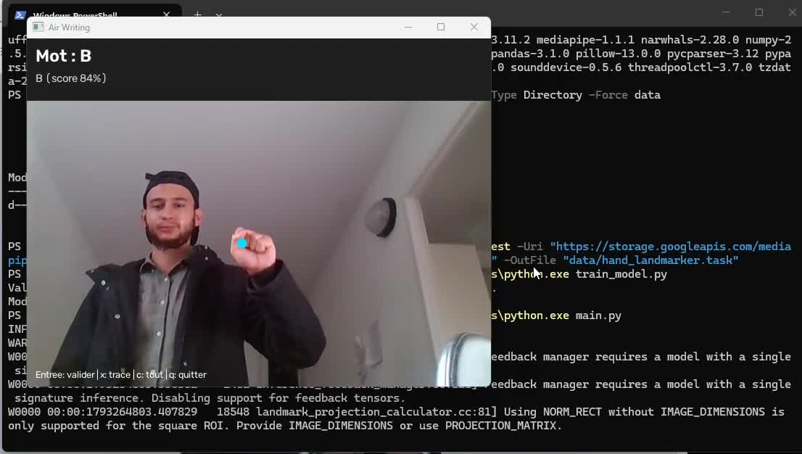

# ✍️ Air Writing — Mots, phrases et lecture vocale FR/EN

**Interaction gestuelle — MediaPipe · OpenCV · EasyOCR · scikit-learn**

Air Writing transforme les mouvements de l'index devant une webcam en un tracé,
puis propose du texte. Deux modes sont disponibles :

- **`words` (par défaut)** : OCR du mot ou de la ligne entière, avec aperçu régulier
  pendant le tracé. Pas besoin de valider chaque lettre.
- **`letters`** : ancien classifieur A–Z, une lettre à la fois, avec suggestions de
  mots français/anglais. `TAB` permet de changer de mode quand le canevas est vide.

**Le mode mots est expérimental.** EasyOCR est un OCR généraliste : écrivez des
lettres **détachées, grandes et proches de caractères imprimés**, de gauche à droite.
Il ne s'agit pas d'un modèle entraîné sur l'écriture aérienne ou sur les mots cursifs.
Les lettres qui se chevauchent, la cursive et les mouvements rapides peuvent échouer.
Aucune précision sur de vrais tracés webcam n'est revendiquée.

## 🎬 Démonstration existante

[](https://github.com/NAZMO1/air-writing/blob/main/docs/media/air-writing-demo.mp4)

[▶ Voir la vidéo (21 secondes)](https://github.com/NAZMO1/air-writing/blob/main/docs/media/air-writing-demo.mp4)

Cette vidéo montre la version précédente, lettre par lettre ; elle ne valide pas
les performances du nouveau mode OCR.

## Installation

Utilisez un environnement Python compatible avec les dépendances et une webcam.
Sous Windows, privilégiez Python **natif Windows** pour accéder à la webcam et aux
voix système ; WSL nécessite une configuration caméra/audio supplémentaire.

```bash
git clone https://github.com/NAZMO1/air-writing.git
cd air-writing
python -m venv .venv
```

Activation :

```bash
# Linux / macOS
source .venv/bin/activate
# Windows PowerShell
.venv\Scripts\Activate.ps1
```

Puis :

```bash
python -m pip install -r requirements.txt
python -m pip install -r requirements-ocr.txt
```

**Important pour la fenêtre webcam :** EasyOCR installe `opencv-python-headless`.
Il partage les fichiers `cv2` avec OpenCV graphique. Réinstallez la version graphique
**en dernier**, après l'installation d'EasyOCR, pour conserver `imshow` :

```bash
python -m pip install --force-reinstall --no-deps opencv-contrib-python==5.0.0.93
```

PyTorch et les poids OCR sont volumineux. Un GPU n'est pas requis (`gpu=False`).
Pour limiter les téléchargements, on peut installer une version CPU compatible de
PyTorch/torchvision suivant [les instructions officielles](https://pytorch.org/get-started/locally/)
avant d'installer `requirements-ocr.txt`. Sur CPU, l'aperçu peut prendre plusieurs secondes.

### Préparer les modèles une seule fois

Téléchargez le modèle MediaPipe dans `data/hand_landmarker.task` :

```bash
mkdir -p data
curl -L "https://storage.googleapis.com/mediapipe-models/hand_landmarker/hand_landmarker/float16/1/hand_landmarker.task" -o data/hand_landmarker.task
```

Avec PowerShell, utilisez `New-Item -ItemType Directory -Force data`, puis `curl.exe`
avec la même URL et la même destination si `curl` est un alias PowerShell.

Préparez explicitement les poids OCR français/anglais (connexion Internet requise) :

```bash
python -m src.text_recognition --download-models
```

Les poids sont conservés dans `data/easyocr/` et exclus de Git. Au lancement normal,
le téléchargement automatique est désactivé. Les images de caméra, les tracés et
le texte ne sont envoyés à aucune API ; la reconnaissance et la synthèse sont locales.

Pour le mode **lettres** uniquement, entraînez aussi le modèle A–Z :

```bash
python train_model.py
```

Le mode mots ne nécessite pas `data/letter_model.pkl`.

### Lancer

```bash
python main.py
# Alternative sans EasyOCR :
python main.py --mode letters
```

Pour mettre à jour une installation existante, faites `git pull`, installez
`requirements-ocr.txt`, réinstallez OpenCV graphique comme ci-dessus et préparez les
poids OCR. Aucun réentraînement du modèle de lettres n'est nécessaire pour l'OCR.

## Choisir sa langue avec la main

Au démarrage, le dessin est désactivé tant que la langue n'est pas choisie :

| Choix | Geste maintenu pendant 1 seconde | Alternative clavier |
| --- | --- | --- |
| Français | Index seul levé | `F` |
| Anglais | Index et majeur levés, autres doigts repliés | `E` |

Le pouce est ignoré pour ces deux gestes. Après sélection, repliez les doigts une
fois avant de dessiner, pour éviter de transformer le geste de sélection en trait.
`L` rouvre ce menu lorsque le canevas est vide. Le texte déjà validé est conservé.
La langue sélectionne l'alphabet OCR autorisé, le dictionnaire en mode lettres et
la voix système ; elle ne traduit pas le texte et ne comprend pas son sens.

## Écrire des mots et des phrases

1. Levez l'index seul pour tracer un mot ou une courte ligne de plusieurs mots.
2. Levez **index + majeur** pour déplacer la main sans dessiner, par exemple entre
   deux traits ou deux lettres. Ce geste ne valide pas automatiquement le mot.
3. L'OCR analyse périodiquement le canevas entier dans un thread séparé. L'aperçu
   reste provisoire : il n'est pas ajouté au document ni lu à voix haute.
4. Maintenez la **paume ouverte 1 seconde**, ou appuyez sur **Espace**, pour valider
   le tracé en texte, ajouter un espace et libérer le canevas pour le mot suivant.
   Un poing maintenu 1 seconde réalise la même validation en mode mots.
5. Continuez ainsi votre phrase. Les espaces déjà présents entre les mots d'une
   ligne peuvent aussi être reconnus par l'OCR. Les touches `.`, `!` et `?` permettent
   de ponctuer explicitement le texte.
6. Appuyez sur **Entrée** pour valider le tracé restant, puis lire **tout le texte**.

Pendant une validation OCR finale, le dessin est temporairement suspendu pour
éviter de perdre des traits arrivés après la capture. `x` annule cette validation
et efface le tracé. Si l'OCR ne reconnaît rien ou obtient un score trop faible,
le tracé reste disponible et aucun texte n'est ajouté. Les résultats arrivant
après un effacement ou un changement de langue ne peuvent pas modifier le document.

Il n'y a pas de correction orthographique silencieuse. Un score OCR élevé n'est
pas une garantie : vérifiez le texte affiché avant de l'utiliser.

### Lecture en continu

`A` active/désactive la **lecture automatique des nouveaux mots ou lignes validés**.
La voix ne lit pas chaque aperçu partiel ni chaque lettre. Les éléments confirmés
sont lus dans l'ordre grâce à une file limitée à 20 éléments en attente. Si elle
est pleine, un message invite à utiliser Entrée pour relire le document.

Entrée remplace la lecture en cours et sa file par la lecture du texte complet.
Désactiver la lecture automatique, changer de langue, effacer tout ou quitter
arrête la voix et vide sa file. Les textes de plus de 2 000 caractères ne sont pas lus
par une demande unique. La caméra reste active pendant la parole.

### Commandes

| Action | Geste / touche |
| --- | --- |
| Tracer | Index seul levé |
| Déplacer sans tracer | Index + majeur levés |
| Valider et ajouter un espace | Paume ouverte 1 s / Espace |
| Valider | Poing 1 s (ajoute aussi un espace en mode mots) |
| Valider le tracé et lire tout le texte | Entrée / `V` |
| Lecture automatique des nouveaux mots validés | `A` |
| Lire le dernier mot validé | `B` |
| Ajouter de la ponctuation | `.`, `!`, `?` |
| Revenir au choix de langue | `L`, canevas vide |
| Changer mots / lettres | `TAB`, canevas vide |
| Effacer le tracé / annuler l'OCR en cours | `x` |
| Effacer texte, tracé et lecture | `c` |
| Supprimer le dernier caractère du texte validé | Retour arrière, canevas vide |
| Valider une lettre sans lire (mode lettres) | `R` |
| Accepter une suggestion et ajouter un espace (mode lettres) | `1`, `2`, `3`, canevas vide |
| Quitter | `Q` |

Les touches de commande alphabétiques s'utilisent en minuscules, sauf `F`/`E`
ci-dessus qui désignent les touches `f`/`e`. La fenêtre OpenCV doit avoir le focus.
**Changement par rapport à l'ancienne version : la paume ajoute un espace ; `c`
efface tout. Entrée valide puis lit ; `R` valide une lettre sans lire.**

## Voix française et anglaise

Installez les voix FR/EN dans les paramètres de langue/parole de Windows ou de
macOS. Sous Ubuntu/Debian, installez le moteur nécessaire à pyttsx3 :

```bash
sudo apt install espeak-ng libespeak1
python -m src.speech --language fr --text "Bonjour tout le monde"
python -m src.speech --language en --text "Hello world"
```

Une voix absente produit un message explicite sans empêcher d'écrire. OpenCV
retire les accents de l'affichage, mais le texte interne et la voix les conservent.

## Mode lettres et modèle existant

Le mode `letters` conserve le MLP A–Z : tracer une lettre, puis maintenir le poing
1 seconde ou appuyer sur `R`. Écrire les lettres suivantes au même endroit après
validation. Les dictionnaires de pyspellchecker proposent jusqu'à trois corrections
(`1`/`2`/`3`), y compris des variantes accentuées françaises. Espace conserve les noms
propres et mots inconnus tels quels. Il faut valider ou effacer le tracé avant de
choisir une suggestion.

`train_model.py` produit par défaut jusqu'à 7 800 exemples synthétiques (300 par
lettre) et entraîne un MLP à couches cachées de 128 et 64 neurones. Le prétraitement
recadre le tracé, le centre dans 28 × 28 et fournit 784 valeurs normalisées. Une
lettre est acceptée avec un score ≥ 0,60 et une marge ≥ 0,15. La validation synthétique
ne mesure pas la précision sur webcam. Essai court :

```bash
python train_model.py --samples 100 --iterations 40
```

## Architecture

| Composant | Rôle |
| --- | --- |
| `main.py` | Caméra, menus de langue, commandes et affichage |
| `src/hand_tracker.py` | MediaPipe Hand Landmarker et 21 repères |
| `src/gestures.py` | Angles articulaires, maintien des gestes et lissage du tracé |
| `src/text_recognition.py` | Canevas vers OCR de ligne, préparation des poids et worker asynchrone |
| `src/editor.py` | Aperçu, validation, protection contre les résultats périmés |
| `src/words.py` | Document, espaces, ponctuation et suggestions FR/EN |
| `src/speech.py` | Processus vocal local et file de lecture |
| `src/classifier.py` / `src/preprocessing.py` | Alternative de classification A–Z |
| `tests/` | Tests sans caméra et intégration avec caméra/OCR/voix simulés |

Le suivi coupe les traits lors d'une perte de main ou d'un grand saut de position.
Les gestes reposent sur les angles articulaires ; occlusions, lumière faible et
main de profil peuvent encore les perturber. La perte de main ne valide rien.
Le worker n'accepte qu'un travail OCR à la fois ; les aperçus sont demandés au plus
une fois par seconde. Ce n'est pas une promesse d'un résultat par seconde : le temps
réel dépend du CPU et de la complexité du tracé. Une pause du dessin permet d'obtenir
un aperçu correspondant au canevas actuel.

## Vérification

```bash
python -m unittest discover -s tests -v
python -m compileall -q main.py src tests
# Essai facultatif avec les vrais poids OCR déjà préparés :
python -m unittest discover -s tests -p 'check_real_ocr.py' -v
```

Les tests automatiques couvrent : aperçu sans validation, phrase complète + Entrée,
espaces et accents, résultat périmé après effacement/changement de langue, OCR lent,
rejet d'un mot incertain, indisponibilité des poids, gestes maintenus, lecture vocale
en file et arrêt propre. Une intégration simule le parcours dessin → OCR → Entrée →
voix. Ils s'ajoutent aux tests existants du classifieur et des dictionnaires.

Les tests avec poids réels utilisent des caractères **imprimés synthétiques** ; ils
ne remplacent pas un test sur tracés aériens. Avant utilisation, essayer à la webcam :
FR puis EN, BONJOUR puis HELLO, plusieurs traits d'une lettre, déplacement à deux
doigts, paume pour l'espace, Entrée pour lire, `A` pour la lecture continue et `x`
pendant une reconnaissance. Vérifier également les voix FR/EN sur les haut-parleurs.

## Pistes suivantes

- Collecter de vrais tracés de mots et constituer un jeu de test indépendant.
- Évaluer un modèle de reconnaissance manuscrite entraîné sur ces tracés, notamment
  pour la cursive ; l'OCR généraliste actuel n'offre pas cette garantie.
- Mesurer les erreurs de mots/caractères et la latence sur plusieurs ordinateurs.

Références : [EasyOCR](https://github.com/JaidedAI/EasyOCR),
[API OCR](https://www.jaided.ai/easyocr/documentation/),
[MediaPipe](https://ai.google.dev/edge/mediapipe/solutions/vision/hand_landmarker).
